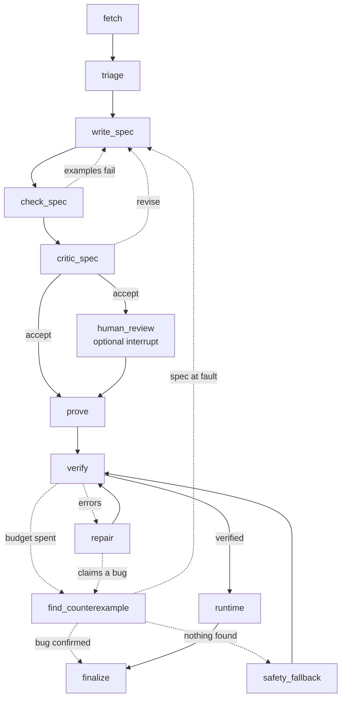

# lcverus — LLM-orchestrated Verus proofs of rustgym LeetCode solutions

Formally verifies the Rust solutions in [warycat/rustgym](https://github.com/warycat/rustgym) with
[Verus](https://github.com/verus-lang/verus), using DeepSeek models for spec writing and proof search and
LangGraph for orchestration.

LeetCode problems come with a precise statement, worked examples and explicit **constraints**. The constraints
become the precondition `pre`, and the statement becomes the postcondition `post`. Verus then proves, for the
**unmodified** rustgym code:

| property | how |
|---|---|
| functional correctness | `ensures post(inputs, result)` |
| no out-of-bounds indexing | Verus obligation on every `v[i]` |
| no integer overflow/underflow (incl. `usize` subtraction), no division by zero | Verus obligation on every arithmetic op / cast |
| termination | `decreases` required on every loop (`exec_allows_no_decreases_clause` is banned) |
| memory safety | safe Rust; `unsafe` is banned by the integrity checker |

If the functional proof fails, the pipeline still tries to prove the **panic-freedom** rows alone (`panic_free`).

## Pipeline



1. **fetch**: LeetCode GraphQL gives the full problem as Markdown (`runs/p<id>/problem.md`, with all examples
   and constraints) and structured examples. Premium-only problems are skipped.
2. **triage** (no LLM): single-function solutions over int/bool/vector types, then `verus --no-verify` on the
   untouched code. Unsupported std APIs are recorded, e.g. `unsupported:slice::impl&%0::sort_unstable`.
3. **write_spec** (`deepseek-v4-pro`): sees the full problem Markdown and the signature, **not the code**, and
   writes `spec fn pre(..)` and `spec fn post(.., result)` over `Seq` views.
4. **check_spec**: the spec must type-check, accept every official example (`pre(input)`, `post(input, output)`)
   and reject mutated wrong outputs (`!post(input, output±1)`, …). Each check is a Verus `proof fn`. It is tried
   with Z3, then `by (compute)`, then with LLM-written proof hints (`deepseek-flash`). Hints can't cheat because
   `assume` and attributes are rejected. A positive example that Verus *evaluates to false* rejects the spec.
5. **critic_spec** (`deepseek-v4-pro`): an adversarial review of the spec against the statement, with the example
   results in hand. On revise, the loop goes back to `write_spec`. On accept, the spec is frozen and hashed.
6. **prove / verify / repair**: the prover (`deepseek-flash`) adds invariants, asserts, proof blocks and lemmas.
   The orchestrator assembles the file itself: frozen spec, then the signature with
   `requires pre(..) ensures post(..)`, then the LLM's body. Every candidate goes through the **integrity checker**
   before Verus runs. Verus errors go to the repair model (`deepseek-v4-pro`), up to `proof_rounds` times.
7. **find_counterexample**: runs when the proof budget is spent, or when repair claims the code is wrong
   (`<suspected_bug>`). It runs the original code, compiled with plain rustc and overflow checks on, on about 60
   boundary and edge-case inputs plus any inputs repair suggested. A failure counts only when proved:
   - `bug:panic`: Verus proves `pre(X)` and the code panics on X.
   - `bug:wrong_answer`: Verus proves `pre(X)` and `!post(X, output)`, and an independent judge's answer E
     satisfies `post(X, E)`. The judge sees only the problem and X, never the code or its output.
   - `spec_suspect`: the judge says X breaks a constraint, or the spec rejects the judge's answer too. The spec goes
     back to the writer with X but not the code's output.

   A confirmed bug stops proof repair, so annotations are never bent to fit a bug. A refuted claim goes back to
   repair as facts. The smallest failing input is reported.
8. **safety_fallback**: retries with `ensures` dropped, proving panic-freedom and termination only.
9. **runtime**: compiles the verified file and runs the LeetCode examples plus the original rustgym `#[test]`s.
   This checks that ghost-code erasure kept the behaviour.

### Trusted base (`lcverus/guards.py`)

- **Code unchanged**: `rustlex.erase` strips all Verus ghost syntax from the LLM's body, and the remaining token
  stream must equal the original rustgym body exactly. Anything unrecognised stays in, so a modification shows up
  as a mismatch (fail closed).
- **Spec unchanged**: the LLM never writes the signature or `requires`/`ensures`, and the spec hash is re-checked.
- **No cheating**: `assume`, `admit`, `external_body`, `external`, `assume_specification`, `uninterp`, `unsafe`,
  `exec_allows_no_decreases_clause`, bodiless proof fns (axioms) and non-whitelisted `#[verifier::..]` are banned.
  Lemma sections may contain only `spec fn` and `proof fn`.
- `tests/test_guards.py` throws deliberate cheats at it. `tests/test_pipeline.py` runs the whole graph with a stub
  LLM: an honest proof verifies, an `assume(false)` proof ends in `proof_failed:guard_violation`, and a wrong spec
  ends in `spec_rejected`.

The residual trust gap is the spec itself. `reports/summary.md` lists every spec, its example results and the
critic's notes for human review. `--review-specs` makes a human approve each one before proving.

## What LangGraph buys here

| feature | used for |
|---|---|
| `StateGraph` + conditional edges | the two repair cycles (spec ↺, proof ↺) and the fallback are explicit, inspectable edges (`lcverus graph`) instead of nested while-loops |
| `SqliteSaver` checkpointing | one thread per problem; every node transition is persisted. Ctrl-C or a crash, then `lcverus run` again, **resumes at the interrupted node**: no LLM calls or Verus runs are repeated |
| `interrupt()` / `Command(resume=…)` | human-in-the-loop spec approval (`run --review-specs`, then `lcverus review <id> --approve/--edit/--reject`) that can pause for days |
| `graph.batch(max_concurrency=…)` | problems run in parallel threads. Verus processes are separately capped by a semaphore (RAM) |
| state reducers | every node appends a metrics event (`Annotated[list, operator.add]`), which drives the per-node token/time table in the report |
| `get_state` | `lcverus status <id>` shows where a problem is and its node-by-node timeline |
| LangSmith (optional) | set `LANGSMITH_API_KEY` + `LANGSMITH_TRACING=true` for full traces of every LLM call |

The report's "Orchestration at work" section counts these: checkpoints, resumes, cycles taken, interrupts,
cache hits, and the parallel speed-up.

## Setup

```bash
./scripts/install_verus.sh          # rustup + Verus release + a glibc-2.35-compatible z3 4.16
python3 -m venv .venv && .venv/bin/pip install -e '.[dev]'
echo "DEEPSEEK=sk-..." > .env       # read by lcverus/config.py
git clone --depth 1 --filter=blob:none --sparse https://github.com/warycat/rustgym.git data/rustgym
git -C data/rustgym sparse-checkout set leetcode/src
```

## Usage

```bash
lcverus scan                        # shape statistics over all 1561 solutions
lcverus select --pilot 30           # Easy + free + Verus-parsable -> data/pilot.json
lcverus run --pilot                 # run (or resume) the pilot
lcverus run --ids 268,485           # specific problems
lcverus run --pilot --review-specs  # pause for human spec approval
lcverus review 268 [--approve | --reject "why" | --edit spec.rs]
lcverus status 268                  # node timeline of one problem
lcverus report                      # reports/summary.md
lcverus rewind 485 verify           # time-travel: re-run from the last checkpoint before a node
pytest                              # 28 tests: guards, parsers, stubbed graph runs, planted bugs (needs Verus)
```

Every problem gets a readable write-up in `reports/problems/p<id>.md`: the original code, each spec draft and why
it was rejected, every proof round with its diff, Verus output and the repair model's rationale, any
counterexample with its evidence, and the outcome.

Per-problem artifacts are in `runs/p<id>/`: `problem.md`, `spec_r*.rs` and their example-check files,
`attempt_*.rs` plus `.log` for every proof attempt, `final.rs`, `runtime.rs`, and `status.json`.
Budgets, models and parallelism are set in `config.yaml`.

## Known limits

- Strict fidelity: solutions that use std APIs without Verus specs (`sort_unstable`, iterator adapters, `f64`,
  `count_ones`, most `HashMap` entry APIs) stay `unsupported`. A curated, human-reviewed set of
  `assume_specification`s would unlock many of them. Those specs would join the trusted base.
- Pilot scope: one function per solution, int/bool/vector types. Helper functions, `String`, `ListNode` and
  `TreeNode` are not handled yet.
- Verus's `by (compute)` crashed on one spec shape in this release. Such checks fall back to "unchecked".
